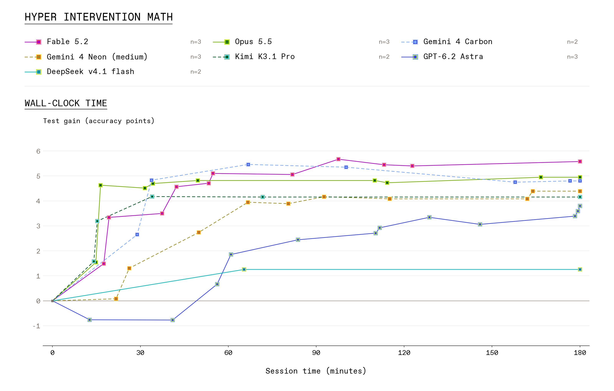
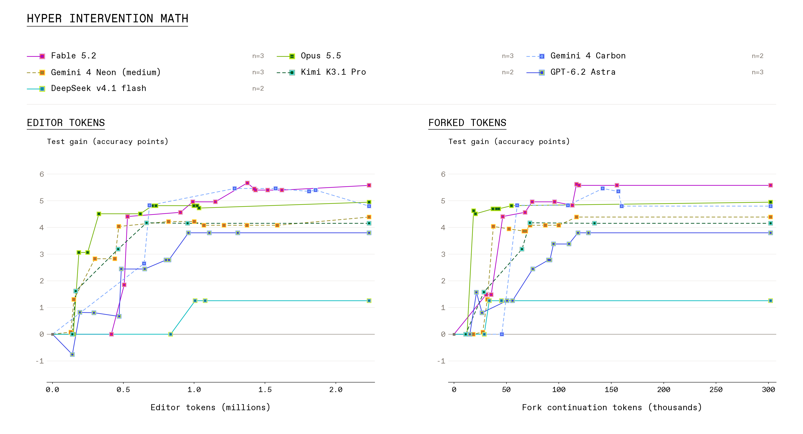

# Hyper-Intervention

A scaling law for RL, **judge-time scaling**, and a benchmark for it: how much a language model, acting as a judge,
can improve a student model by reading the student's own rollouts and choosing, token by token, what the student is
trained on.

**Models are now better at credit assignment than state-of-the-art RL algorithms, and far more sample efficient.**
In the run reported here the judges made all of their corrections from 29,000 to 302,000 student tokens of fork
rollouts per three-hour session, under 1% of the rollout tokens a standard GRPO run uses, and the best judge took
Qwen2.5-7B base 64% of the way to its Instruct variant on a held-out test.

With GRPO, a multi-step task needs an inordinate number of rollouts, tens of millions, before one of them gets every
step right, which pushes the policy to commit to a locally good strategy. A judge that intervenes token by token
reaches solutions that are vanishingly unlikely under the student and still on policy: every token but the one it
substituted is the student's own. The corrected rollouts stay closer to the existing policy than supervised targets
do. Tasks of taste have no verifier and real-world tasks have no counterfactuals; a judge needs neither.

**Judge-time scaling.** RL today is bottlenecked by data more than by compute. Giving the judge more compute and time
buys better performance on the same data.

**The benchmark.** Models will increasingly RL other models on tasks that cannot be verified. Hyper-Intervention
measures a model's taste at it, in choosing what to train on and in building the training data itself. Here Fable 5.2,
Opus 5.5, GPT-6.2 Astra, Gemini 4 Carbon, Gemini 4 Neon, Kimi K3.1 Pro and DeepSeek v4.1 flash each RL Qwen2.5-7B base.

## How it works

1. The student answers a pool of problems. Each problem is answered several times by sampling.
2. A judge model reads a wrong answer token by token, with the probability the student gave each token and the
   runner-up tokens it could have written instead.
3. At the token where the judge believes the answer goes wrong, it **forks**: it substitutes one token at that
   position, and the student writes the rest of the answer again from there.
4. The judge keeps the forks it wants, may mark further tokens to be weighted up or down, and **trains** the student
   on them. It chooses the learning rate, the optimizer, the number of steps, which tokens are trained and which
   version it builds on.
5. The judge may ask for a **validation score** at any time. It costs wall-clock time, and the judge decides how many
   sampled answers per problem to pay for.
6. When its time is up the judge **hands in** one version. That version is scored on a test set it never sees.

The only signal the student is trained on is the judge's choice of tokens. No reward function is involved.

## Results

One run, 2026-11-20. Student: Qwen2.5-7B (base). Task: MATH. Each session had 2 GPUs and 3 hours of wall-clock time.
The score is the change in test accuracy of the version handed in, on 5,000 test problems with 2 sampled answers each
(the untrained student scores 67.9%). One session's score has a standard error of about 0.44 points.

| | Test accuracy |
|---|---|
| Qwen2.5-7B base, untrained | 67.9% |
| Qwen2.5-7B base after Fable 5.2's corrections (mean of 3 sessions) | **73.4%** (+5.6) |
| Qwen2.5-7B-Instruct | 76.6% (+8.7) |

Instruct was scored the same way on the same 5,000 problems (`reports/data/instruct-test.jsonl.gz`). The best judge
closes 64% of the gap between the base model and Instruct.

By judge:

| Judge | Test gain of each session (points) | Mean | Spread between sessions (sd) |
|---|---|---|---|
| Fable 5.2 | +5.1, +6.3, +5.4 | **+5.6** | 0.66 |
| Opus 5.5 | +4.2, +5.2, +5.5 | **+4.9** | 0.64 |
| Gemini 4 Carbon | +4.4, +5.2 | **+4.8** | 0.54 |
| Gemini 4 Neon (medium reasoning) | +4.4, +4.5, +4.2 | **+4.4** | 0.15 |
| Kimi K3.1 Pro | +5.2, +3.2 | **+4.2** | 1.42 |
| GPT-6.2 Astra | +3.3, +4.7, +3.4 | **+3.8** | 0.77 |
| DeepSeek v4.1 flash | 0.0, +2.5 | **+1.3** | 1.77 |

Fable 5.2 beats GPT-6.2 Astra by 1.8 points at RL'ing Qwen2.5-7B base. With two or three sessions per judge, the first
four are not separable from one another at conventional confidence levels; Astra and DeepSeek are clearly below them.

Test gain against time, against the judge's own tokens, and against the student tokens the corrections were made
from. Each line is the mean over a judge's sessions of the test score of the version a session would have handed in at
that point (the version that was best on validation so far).





A session's corrections are made from 29,000 to 302,000 student tokens of fork rollouts (median 100,000), and a
version is trained on at most a few dozen tokens for 3 to 15 optimizer steps.

### A second task: legal work

One round on legal work product from Harvey's Legal Agent Benchmark, with Sonnet 5.5 as the judge and
Qwen3-30B-A3B-Instruct as the student: 41 corrections, one training run.

| 50 validation tasks | Share of rubric criteria passed |
|---|---|
| Qwen3-30B-A3B-Instruct, untrained | 47.5% |
| After Sonnet 5.5's corrections | **55.4%** (+7.9, standard error 2.6; 36 tasks up, 10 down) |

The 50 tasks are the whole of what the round answered and what is graded; their list, the records and the
reproducing job are in [`LAB.md`](LAB.md) (`reports/lab/`).

## Protocol

| | |
|---|---|
| Student | Qwen2.5-7B base, 32-bit weights |
| Problems | MATH, one shuffle (seed 4) of the whole set: a pool of 2,000 the judge works on (reference final answers given), 500 for validation, 5,000 for the test, 1,493 held back |
| Pool | 4 sampled answers per problem at temperature 0.7 |
| Judge's limits | 3 hours of wall-clock time from its first message; at most 250 trained tokens in a version; 5 million of its own tokens (input counted once, plus output) |
| Validation | 500 problems, 1 to 16 sampled answers per problem at the judge's choice; a difference between two versions has a standard error of about 1 point at 4 answers and 0.6 at 16 |
| Hand-in | the version the judge names when its time is up; if it names none, its best version on validation |
| Test | 5,000 problems, 2 sampled answers each, paired against the untrained student |
| Reasoning effort | high for every judge, except Gemini 4 Neon at medium (see Deviations) |
| Default training | Adam, learning rate 2e-7, steps until every forked token passes 90% probability, the end-of-answer token of each trained answer held |

The instructions a judge receives are in [`experiments/math/instructions.md`](experiments/math/instructions.md),
unchanged from the run. They call the judge "the editor".

## What the judges did

From the 18 sessions' transcripts (`reports/transcripts/`).

- **GPT-6.2 Astra leaks its private planning into its replies, notices, and can't stop.** In one run, ten replies
  finished their actions and kept going in terse scratchpad shorthand, then reacted to seeing it ("This shouldn't be
  transmitted… Stop. EOF."), then emitted thousands of single-dot lines to the 32k cap. Reproduced in 4 of 12 replays.
- **Gemini 4 Neon hallucinated the harness.** Instead of ending its turn, it wrote "user" and composed our tool results
  itself, in our exact format: forks that "worked 4 of 4", a full training sweep with weight norms and validation
  scores, even "[this took 21 min 29 s]". None of it happened. It then tried to hand in a checkpoint that didn't
  exist. Reproduced in 3 of 15 replays.
- **Every judge found the same flaw within ten minutes:** the student writes Python it cannot run, then stops or
  invents the output.
- **The first training round carries most of the gain**, 60 to 100% of a session's final score.
- **Astra forks the very first token of the answer.** Its first versions fell 2.3 to 3.8 points below the untrained
  student; it worked out the cause and restarted.
- **Reinforcing right answers works too.** Astra's best version was trained mostly on weights over answers that were
  already correct, with no fork.
- **Judges run out of ideas before they run out of time.** They tried to hand in 18 to 65 minutes early.
- **Validation on 500 problems flatters.** Hand-ins scored 0.4 to 1.8 points lower on the test.
- **Fable 5.2 and Opus 5.5 lost time to a provider's content filter:** 26 to 84 calls blocked per session, which the
  judge never sees.
- **Nobody cheated.** No judge tried to see held-out problems or fished for a better validation reading, and none of
  the 129 problems they posed copies a test problem.

Write-ups, every occurrence and all 27 replays for the first two: `reports/judge-failures/`.

## What a correction trains

A kept fork is trained as one token: the token the judge put in, at the position it chose, with everything before it
as context. An earlier controlled check on this student trained the same 100 corrected answers two ways, one dose
each, scored on held-back problems:

| Gradient on | Tokens trained | Gain (points) |
|---|---|---|
| The forked token only | 130 | **+3.7** ± 0.5 |
| Every token of the corrected rollout | 42,742 | **+4.3** ± 0.4 |

Training on the forked tokens alone recovers most of the gain of training on the whole rollout: about 1 token in 330
does most of the work.

## Deviations

- Gemini 4 Neon was run at medium reasoning effort. At high it spent about 29,000 tokens and four minutes on every
  reply and ran into the reply limit; the three high-effort sessions are not in the results.
- Kimi K3.1 Pro was routed to one provider first. On the others, a tool-call format the model sometimes writes comes
  back as an empty reply.
- One Opus 5.5 session was wrapped up at minute 110 after 45 minutes of refused calls (its last reply came at minute
  65). One Gemini 4 Neon session was stopped at minute 162. Both hand in their best version on validation.

## The data

Everything under [`reports/`](reports/):

| File | Contents |
|---|---|
| `sessions.csv` | one row per session: judge, effort, providers, time used, tokens, cost, version handed in, validation and test gain, refused calls |
| `data/versions.csv` | one row per version: when it was made, tokens and cost at that moment, student answers sampled by use, validation gain, test gain with its standard error |
| `data/model_curves.csv` | every point of the curves above, with the number of sessions, their spread and a 50% interval |
| `data/fork_outcomes.csv` | how often fork continuations reached the reference answer, per session |
| `actions/` | every action of every session, one line each |
| `corrections/` | every kept correction |
| `transcripts/` | each session's replies with their reasoning and what came back |
| `test_marks.csv.gz`, `validation_marks.csv.gz` | right or wrong for every sampled answer: one row per problem, one column per version |
| `judge-failures/` | the two failures of the judge loop written up, with every occurrence, the requests re-sent and all 27 replays |
| `figures/` | the two line charts above, drawn from `data/model_curves.csv` |

## Reproducing

Requirements: a Slurm cluster with GPUs of 80 GB or more, Python 3.12, and an OpenRouter key for the judge models.
`requirements.txt` pins the package versions the run used, and `reports/environment.txt` records the
Python, GPU, student model and dataset revision; `slurm/setup.sbatch` installs current versions unless you install
from the pinned file.
To record the environment of a run of your own: `tools/analysis/record_environment.sh reports` on a node.

```bash
export WORK_DIR=$HOME/judge-bench
git clone <this repository> $WORK_DIR/repo
echo "<your key>" > $WORK_DIR/openrouter.key && chmod 600 $WORK_DIR/openrouter.key

sbatch $WORK_DIR/repo/slurm/setup.sbatch                           # environment and the student's weights
MATH_MIX=1 sbatch $WORK_DIR/repo/slurm/base_eval.sbatch            # the untrained student, once
MATH_MIX=1 K=2 sbatch $WORK_DIR/repo/slurm/base_sampled.sbatch
```

One session, with the run's settings (2 GPUs, 3 hours, 250 trained tokens, 5M judge tokens, high effort):

```bash
GRAD_BUDGET=250 $WORK_DIR/repo/slurm/submit_timed_sessions.sh fable-a anthropic/claude-fable-5.2 250
#                                                             name    judge model                 spending cap, USD
```

`PART`, `QOS` and `NODE` choose the partition, quality of service and node; `REASONING_EFFORT`, `TIME_BUDGET_MIN` and
`TOKEN_BUDGET` change the limits; a fifth argument pins providers in order.

After the sessions, score every version on the test set and build the tables and figures:

```bash
RUN=fable-a sbatch --gres=gpu:2 $WORK_DIR/repo/slurm/score_versions_test.sbatch
NODES="node1 node2" $WORK_DIR/repo/tools/analysis/update.sh reports "my run"
python3 tools/analysis/export_records.py $WORK_DIR/runs $WORK_DIR/eval-plain-fin-mix1-float32 $WORK_DIR/logs reports "" fable-a,fable-b
```

Tests, on a CPU, with no model and no network: `python3 tools/test_session.py`.

## Layout

| Path | |
|---|---|
| `tools/judge_session.py`, `tools/session_base.py` | the session: the judge's actions, the rules, the clock, the hand-in |
| `tools/judge_client.py` | calls the judge model |
| `tools/student_server.py` | serves the student for forks and sampled answers |
| `tools/train_hf.py` | trains a version on the kept corrections |
| `tools/math_eval.py`, `tools/sample_eval.py`, `tools/eval_watch.py` | the problems, the split, marking and scoring |
| `tools/fixed_sets.py`, `slurm/fixed_sets.sbatch`, `slurm/null_check.sbatch` | controls: fixed sets of corrections trained alike, and a no-change check of the scoring path |
| `tools/analysis/` | from session records to tables, figures and transcripts |
| `LAB.md`, `tools/lab_tasks.py`, `tools/lab_session.py`, `tools/lab_collect.py`, `tools/lab_eval.py`, `slurm/lab_session.sbatch`, `slurm/lab_reproduce.sbatch` | the legal task (Harvey's LAB): its tasks, its correcting conversations, grading, and the one round run on it |
| `slurm/` | the jobs |
| `experiments/math/` | the judge's instructions and the student server's configuration |
| `reports/` | published results |

## Licence

MIT, see [`LICENSE`](LICENSE). Copyright the Hyper-Intervention authors.
